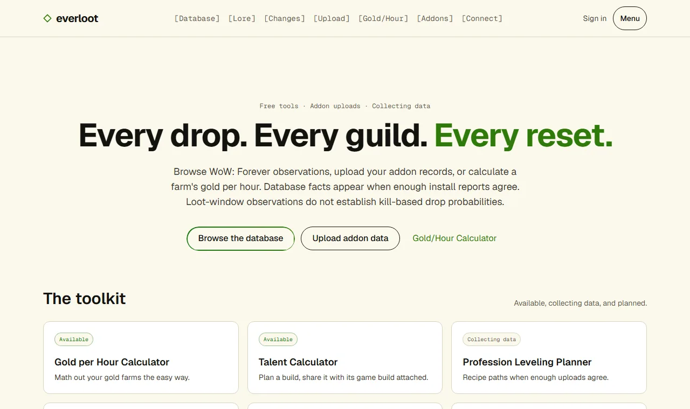
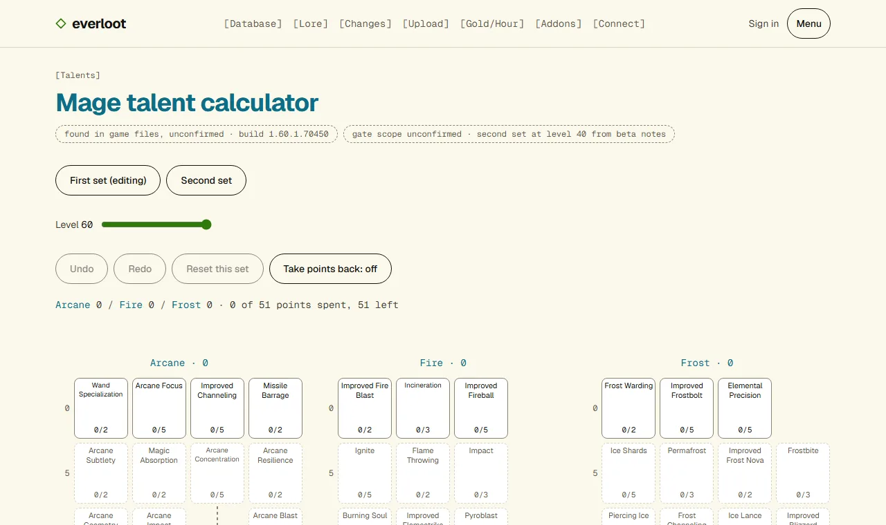
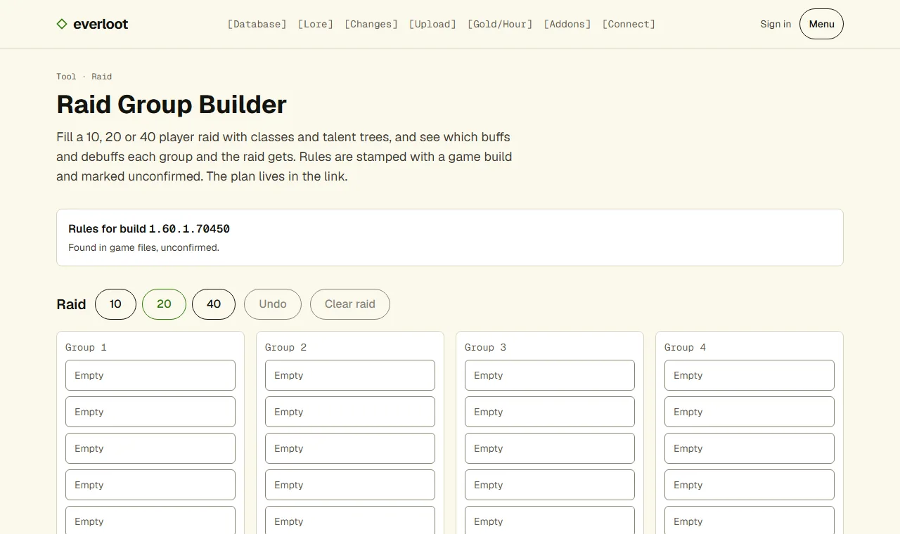
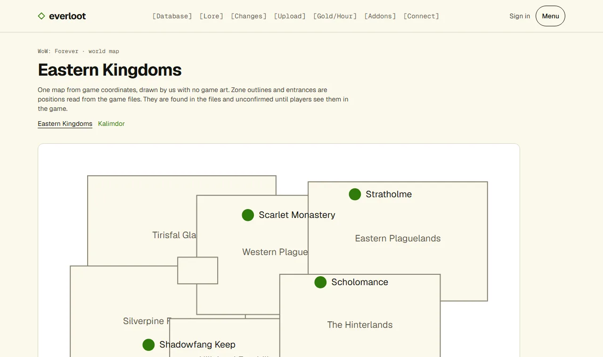
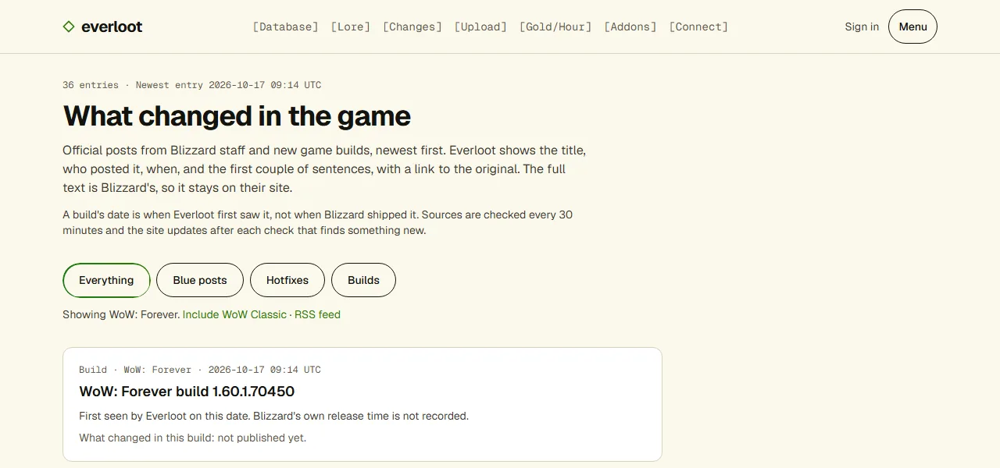
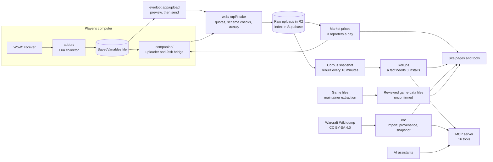

# Everloot

**An open, player-built database for World of Warcraft: Forever. An addon records what you see, and
the site states a fact only once three installs agree.**

[](https://github.com/CDVolvik/everloot/actions/workflows/checks.yml)
[](LICENSE)
[](docs/DATA_POLICY.md)
[](https://everloot.app)
[](https://github.com/CDVolvik/everloot/releases)



Everloot is a fan project. WoW: Forever launches on **2026-11-04**, and Everloot is built to have
real answers on day one: drop rates, vendor prices, recipe ranges, spawn points, talent trees, what
changed in the latest build. Players supply the observations. The site shows each fact with the
number of installs that reported it and the date, and anyone can read the anonymous records behind
the count.

It does not scrape other sites and never touches the running game. The addon uses the game's own
addon API and writes its own save file. Everything that comes from the game files is labelled
unconfirmed until players have seen it, and spoilers are hidden by default. The full rules are in
[`docs/DATA_POLICY.md`](docs/DATA_POLICY.md).

## What is live on everloot.app

**Database.** Items, NPCs, quests, vendors, professions and auction history, built from player
uploads. A figure appears once three installs report it, with the count and the data's age beside it.
[everloot.app/database](https://everloot.app/database)

**Talent calculator.** Plan a build for any class: point rules, two talent sets, undo, and a share
link that names the game build. The addon can load that plan and show you the next point to spend.
[everloot.app/tools/talents](https://everloot.app/tools/talents)



**Raid builder.** Fill a 10, 20 or 40 player raid with classes and talent trees and see which buffs
and debuffs each group and the raid gets. The plan lives in the link.
[everloot.app/tools/raid](https://everloot.app/tools/raid)



**World map.** One map drawn by us from zone and entrance positions in the game files, with no game
art. [everloot.app/map](https://everloot.app/map)



**Change tracker.** Blizzard staff posts, hotfixes and new game builds, newest first, with a link to
the original and an RSS feed. [everloot.app/changes](https://everloot.app/changes)



**Lore archive.** The Warcraft Wiki (CC BY-SA 4.0), browsable by type and searchable.
[everloot.app/lore](https://everloot.app/lore)

**Addon leaderboard and profiles.** Which addons Forever players run, for the players who opt in to
share their list. A count appears only when three installs report it.
[everloot.app/addons/popular](https://everloot.app/addons/popular)

**Connect.** How to use the open data from an AI assistant or your own code.
[everloot.app/connect](https://everloot.app/connect)

**Market prices.** Blizzard has no auction API for Forever, so prices come from full auction scans
that players start with the addon's **Everloot scan** button. The site shows a realm table and a
60-day chart per item, a day is published once three reporters agree, and the same prices appear in
item tooltips in game. [everloot.app/tools/auctions](https://everloot.app/tools/auctions)

**MCP server.** 16 tools that let an AI assistant search the archive and read the same sourced
facts the site shows: items, NPCs, quests, vendors, profession paths, recipe ranges, auction history,
market values, recent Blizzard changes and more. The public endpoint is read only and rate limited:
`https://everloot.app/mcp/public`.

## How it fits together



| Part | What it does |
|---|---|
| [`addon/`](addon/) | The in-game collector (Lua) and the `/ask` command |
| [`web/`](web/) | everloot.app: the database, tools, map, change tracker, lore archive, upload page and MCP endpoints (Next.js on Vercel) |
| [`kb/`](kb/) | The knowledge base: lore import, public releases, the game-file extractor and the MCP server (TypeScript, SQLite) |
| [`companion/`](companion/) | A desktop helper that uploads your file and answers `/ask` in game |
| [`supabase/`](supabase/) | The site's database schema |

[`docs/architecture.md`](docs/architecture.md) goes into the boundaries and the decisions behind them.

## Quick start

### Players

1. Download the addon from [everloot.app/upload](https://everloot.app/upload) and extract
   `Everloot/` into the game's `Interface/AddOns/`.
2. Play. Log out, or type `/reload`, to save.
3. Upload `WTF/Account/<account>/SavedVariables/Everloot.lua` at everloot.app/upload. You preview
   everything before it is sent.

Auction capture and the list of your installed addons are off until you turn them on
(`/everloot auctions on`, `/everloot addons on`). To see market prices in item tooltips, the
[companion](companion/README.md) writes them into the game folder (`prices --game`); the addon's scan
button on the auction house adds your own scan.

### Developers

You need Node 22 and Python 3.12 (for the addon tests).

```bash
git clone https://github.com/CDVolvik/everloot.git
cd everloot
(cd kb && npm install)
cd web && npm install
npm run sample-release   # prints a KB_SNAPSHOT_PATH line: put it in web/.env.local
npm run dev              # http://localhost:3000
```

The sample release gives you about 35 lore pages to work with. Pages that need storage say it is
unavailable, which is expected locally. Each part's README has its test commands, and
[`CONTRIBUTING.md`](CONTRIBUTING.md) lists what CI runs.

### AI-assistant users

Point any MCP client at the public endpoint:

```bash
claude mcp add --transport http everloot https://everloot.app/mcp/public
```

or put `{ "mcpServers": { "everloot": { "type": "http", "url": "https://everloot.app/mcp/public" } } }`
in the client's config. The [connect page](https://everloot.app/connect) lists the tools, the rate
limit and how to credit the data.

## Project status

Beta. The addon is at 0.3.0 and passes its automated tests; the in-client checks in
[`docs/2026-10-08-beta-client-checklist.md`](docs/2026-10-08-beta-client-checklist.md) are still open
until the game is playable. The game-file layers (talents, raid buffs, map) are read from build
`1.60.1.70450` and marked unconfirmed. A [build watch](docs/BUILD_WATCH.md) checks for new builds
every half hour and opens a reviewed pull request when one appears. WoW: Forever launches on
2026-11-04.

What is next is in [`ROADMAP.md`](ROADMAP.md). What has shipped is in [`CHANGELOG.md`](CHANGELOG.md).
Nightly pre-releases of the addon are on the [releases page](https://github.com/CDVolvik/everloot/releases).

## How to help

You don't need to write code. Playing with the addon and uploading, or reporting a wrong fact, helps
as much as a pull request.

- Questions and ideas: [GitHub Discussions](https://github.com/CDVolvik/everloot/discussions)
- Bugs and wrong data: [issues](https://github.com/CDVolvik/everloot/issues/new/choose)
- A first code contribution: issues labelled
  [`good first issue`](https://github.com/CDVolvik/everloot/labels/good%20first%20issue)
- Chat: the Everloot Discord opens at launch
- Security problems: [`SECURITY.md`](SECURITY.md), never a public issue

Read [`CONTRIBUTING.md`](CONTRIBUTING.md) first: it covers sign-off (`git commit -s`), pull request
titles and the data rules.

## Documentation

[`docs/README.md`](docs/README.md) is the index. The ones you will want first:

- [`docs/DATA_POLICY.md`](docs/DATA_POLICY.md): what we publish, what we refuse, and why
- [`docs/architecture.md`](docs/architecture.md): the service and data map
- [`docs/RELEASING.md`](docs/RELEASING.md): stable and nightly releases
- [`docs/sources/LEDGER.md`](docs/sources/LEDGER.md): every source we have used
- [`docs/design/`](docs/design/): design specs and plans, by date

## Licence

Code: [AGPL-3.0-only](LICENSE), © 2026 R21 Media Group, LLC and Everloot contributors.
Published data: CC BY-SA 4.0, credited to Everloot contributors. Third-party material:
[`THIRD_PARTY.md`](THIRD_PARTY.md). The Everloot name and logo are not covered by these licences:
[`TRADEMARKS.md`](TRADEMARKS.md).

World of Warcraft is a trademark of Blizzard Entertainment, Inc. Everloot is a fan project and is
not affiliated with or endorsed by Blizzard.
