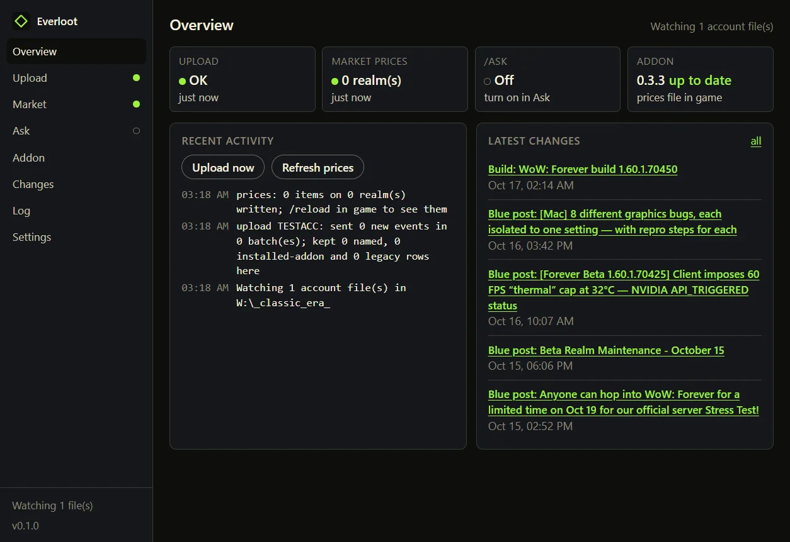

# desktop/: Everloot Desktop App

The companion as an app. It sits in the system tray beside the game and does what the
[command line](../companion/README.md) does, without a terminal: after every logout or `/reload`
it uploads the addon's anonymous observations, keeps community market prices in your item tooltips,
and, if you turn it on, answers `/ask` questions. Design:
[`docs/design/specs/2026-10-18-desktop-app-design.md`](../docs/design/specs/2026-10-18-desktop-app-design.md).



It sends nothing the command line does not send, and it follows the same rules
([`docs/DATA_POLICY.md`](../docs/DATA_POLICY.md)): anonymous events only, named data stays on your
computer, nothing touches the game client. The window never shows an ad.

## Install

Downloads are on the [releases page](https://github.com/Everloot/everloot/releases) under
`desktop-v*`: a Windows installer and a portable exe, a macOS disk image, a Linux AppImage. The
builds are not code-signed yet, so Windows shows a SmartScreen notice (More info, Run anyway) and
macOS needs a right-click, Open the first time. The `SHA256SUMS` file on each release lets you check
a download.

On first run the app shows what leaves your computer, finds your World of Warcraft folder (or you
browse to the product folder that holds `WTF`, for example `World of Warcraft\_classic_era_`), and
runs nothing until you press **Start**.

## What it does

| Job | What | When |
|---|---|---|
| Upload | Sends events the site has not confirmed, from every account's `Everloot.lua` under the game folder | After the game writes the file (logout or `/reload`), once the write settles |
| Market prices | Writes the `EverlootPrices` slot addon for the realms you scanned plus the realms you follow | After each upload and every hour |
| `/ask` | Answers pending `/ask` questions into the `EverlootAnswers` slot addon | After the game writes the file; needs an MCP URL and a token file on the Ask page |

The window is a sidebar with one page per thing to manage:

| Page | What it shows and does |
|---|---|
| Overview | The four states at a glance (upload, prices, `/ask`, addon), recent activity, the latest Blizzard changes |
| Chat | Ask anything about the game, or about your own characters. With a provider the model works Everloot's own MCP tools itself and names the sources; three local tools read your characters' gold, gear and progress, each realm's last scan, and the app's own status (what is on, what failed and why, the addon and app versions) from this computer, never uploaded, sourced as "this computer". When the tools have nothing it answers from its own knowledge and says so. Providers are your own account, picked on the page: an Anthropic key, an OpenRouter key (cheap or free models), an OpenCode Zen key (its zero-retention free models), an Ollama on this computer, or any OpenAI-compatible server. The key goes into a file in the data folder and `config.json` names it, so the in-game `/ask` uses the same pick. With no provider you get the sourced search hits as they are. Claude.ai and ChatGPT subscriptions cannot be used: both companies allow API keys in other apps, not their consumer sign-ins. The transcript stays in your data folder |
| Characters | Your own characters from the save file: gold with a line of every snapshot the addon kept and the last seven days as earned, spent and net, peak, item level, and the completion tracker's progress per character key. Never uploaded from here |
| Upload | Each account file: when it was written, addon and client build, records per kind, how many the site confirmed. Run now |
| Market | Realm picks: your scanned realms are always carried; tick more from the realms the site has public values for (TSM-style realm picks, on Everloot's own scan data). When you last scanned each realm, with a reminder past a day. What the last refresh wrote |
| Ask | MCP server and token file, which provider answers (`config.json`), questions pending in game, recent answers |
| Addon | Installed version against the latest `addon-v*` release, install or update in one click (the zip is checked against the release's `SHA256SUMS` before anything is written), the slot addons' state |
| Changes | The site's change tracker feed: Blizzard posts, hotfixes and builds |
| Log | Everything the engine did this session, with Pause |
| Settings | Game folder, site, launch at login, start in tray, data folder, check for updates |
| Site tools | The talent calculator, raid builder, database, auction prices, world map and lore archive, shown inside the window as the site itself. The view tells the site it is inside the app (an `EverlootDesktopApp/<version>` user-agent token), so the site can leave its ads out. Links elsewhere open in your browser |

The tray menu shows each job's last result, a reminder when a realm's last full scan is older
than a day, the newer app release when there is one, and Upload now, Refresh prices now, Pause and Quit.
Closing the window keeps the app in the tray. The window opens where you left it, at the same
size, unless that screen is gone. The release checks (app and addon) run at start, after the first Start, and once a day
after that.

The app shares its data folder with the command line (`%APPDATA%\Everloot`,
`~/Library/Application Support/Everloot`, `~/.config/everloot`): `sent.json` for confirmed events,
`answers.json`, `settings.json`, `chat.json`, a `backups/` folder with the newest ten copies of each
account's `Everloot.lua` as uploaded (the Upload page lists them and can restore one while you are
logged out; the file it replaces is backed up first), and the optional `config.json` for `/ask` model providers (same
format and same rules as the [companion README](../companion/README.md#providers-design-sections-6465):
keys come from a file named by `apiKeyFile`, never from the config itself).

## Run it from source

```
cd web && npm install && cd ../companion && npm install && cd ../desktop
npm install
npm start
```

`npm start` bundles `src/` with esbuild into `dist/` and opens Electron. The bundle includes the
companion's modules and the site's parser (`web/src/lib/sv-parse.ts`), so `web` and `companion`
must be installed too.

```
npm test            # vitest: every module under src/main and the renderer's text helpers
npm run typecheck
npm run pack        # installers into release/ (electron-builder)
npm run icons       # remake build/*.png from web/src/app/icon.svg
```

Set `EVERLOOT_DATA_DIR` to a scratch folder to keep a development run away from your real
`sent.json` and settings. For a screenshot: `npx electron . --remote-debugging-port=9333`, then
`node scripts/screenshot.mjs shot.png`.

## Where things live

| Path | What |
|---|---|
| `src/main/index.ts` | Electron: single instance, the window, the tray, IPC handlers |
| `src/main/engine.ts` | Watches the account files and runs the jobs; every job is injected, so tests need no network |
| `src/main/jobs.ts` | The jobs, built on `companion/src` (uploader, prices, bridge) |
| `src/main/market.ts`, `inspect.ts`, `addon.ts`, `changes.ts` | Realm picks and the prices file, what a save file holds, addon install with checksum, the changes feed |
| `src/main/agent.ts`, `chat.ts` | The agent over the MCP server (the tool loop on Anthropic's API or any OpenAI-compatible one, or plain search) and the Chat page's transcript |
| `src/main/local-tools.ts` | The three tools the model can call about this computer: `my_characters` and `my_realm_scans` from the save files, `my_app_status` from the app's own job status; text only, through the same reads the Characters, Market and Overview pages use |
| `src/main/characters.ts` | Gold, gear and progress per character from the save file |
| `src/main/backups.ts`, `providers.ts` | The dated copies of each account file and their restore; the picked provider's key file and its `config.json` entry |
| `src/shared/providers.ts` | The provider presets the Chat page offers: base URLs, key shapes, the curated models and their data notes |
| `src/main/window-state.ts`, `json-file.ts` | The window's remembered size and place; JSON files read with a byte order mark allowed |
| `src/main/site-views.ts` | The embedded site tools (one browser view, kept on the site's origin) |
| `src/main/settings.ts`, `game-folder.ts`, `updates.ts`, `external.ts` | Settings file, where the game is, the release check, the browser allow-list |
| `src/preload.ts` | The only bridge the page can call (`window.everloot`) |
| `src/renderer/` | The window: one page, no framework, the site's colours; `format.ts` holds the text helpers, tested without the DOM |
| `src/shared/types.ts` | Shapes both sides use |
| `build/` | App and tray icons |
| `scripts/` | The esbuild bundle, the icon maker, the screenshot helper |

## Release

Set the version in `package.json`, add a `desktop-vX.Y.Z` section to the root `CHANGELOG.md`, tag
`desktop-vX.Y.Z` and push the tag. Before the first tag of a version, run the same workflow by hand
(`gh workflow run desktop-release.yml --ref <branch>`): it builds the three installers as workflow
artifacts and publishes nothing. `.github/workflows/desktop-release.yml` builds on Windows, macOS
and Ubuntu, runs the tests, and publishes the GitHub release with `SHA256SUMS`.
