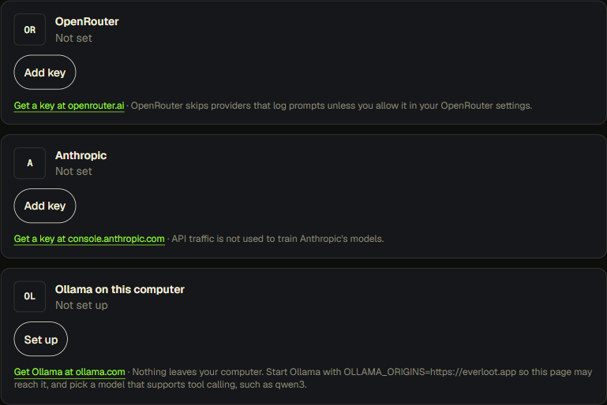
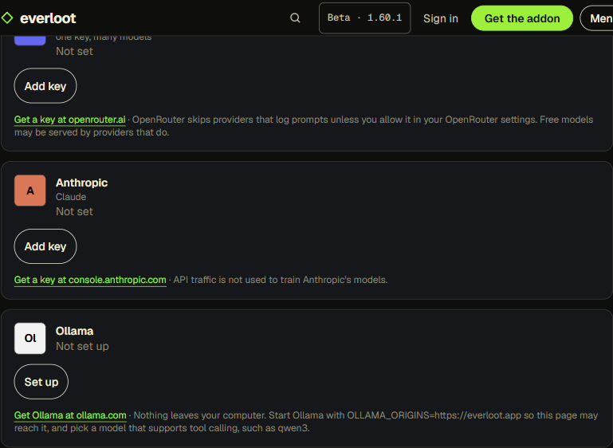

# Lane 5 closeout: the model catalogue behind Chat

2026-10-21. Branch `feat/model-catalogue`.

## What changed

**One catalogue, read by both.** `web/src/lib/chat/catalogue.ts` is the only list of providers and models. The website's `web/src/lib/chat/providers.ts` and the Desktop App's `desktop/src/shared/providers.ts` are now thin views of it. The website takes the providers that passed the CORS test below; the Desktop App takes all of them, plus "Another OpenAI-compatible server". The two copies had drifted: Gemini 3.5 Flash Lite was $0.30 / $2.50 on one and is $0.15 / $1.25 on OpenRouter today, and the OpenRouter key hint differed. They cannot drift any more.

**The logic is per provider, never per model.** A provider is a row of data: base URL, key pattern, key hint, the calling path (Anthropic's Messages API or OpenAI-compatible chat completions), how its model list is read, and any headers it asks for. A model is a line: id, label, price note. Adding DeepSeek, Kimi or any of the others needed no new calling code.

**The list comes from the provider, so it is never stale.** `listModels` reads it at runtime:

- OpenRouter: `GET /api/v1/models`, which is public. The picker shows the catalogue's lines first at today's price, then every other model that calls tools and is free or under a dollar per million tokens either way. Batch variants are left out. Checked live today: 153 models.
- Anthropic: `GET /v1/models` with the saved key.
- Ollama: `GET /api/tags` for the models the player pulled.
- Every other provider: `GET {base}/models` with the saved key. Embedding, audio and image models are left out.

When the provider cannot be reached, the catalogue's lines are shown instead. On the website the read goes from the browser to the provider. In the Desktop App it goes from the main process, over a new `chatModels` IPC call, with the key from its file in the data folder. Either way, the key goes to that provider alone.

**The tiles look deliberate.** Each provider is a monogram tile on its own colour, with black or white letters, whichever reads better (tested to at least 4.5:1 contrast). The provider's full name sits beside the tile, with what it is for underneath. No logo files are committed. The colours were picked by eye; they are not brand-sheet values. The Desktop App's provider picker shows the picked provider's tile next to the menu. Its saved-key chips and the Settings key rows carry the tile too. Its CSP allows no inline styles, so `render()` paints the tiles the way it already sets bar heights.

**More providers on the website, without a wall of cards.** OpenRouter, Anthropic and Ollama stay open. The ten direct providers wait under "More providers" until one is saved.

**`x-title` goes to OpenRouter only.** The site sent `x-title: Everloot` to every OpenAI-compatible provider. Moonshot, MiniMax, Google and Mistral refuse it in the CORS check. It is now a header on OpenRouter's row.

**Test works for every keyed provider.** The site's Test button now checks any keyed OpenAI-compatible provider with its model list and the key.

| Before | After |
|---|---|
|  |  |

[The "More providers" section, opened](media/2026-10-21-chat-keys-after-more.png)

## The catalogue

20 providers and 58 model lines: 13 on the website and in the Desktop App, 7 in the Desktop App only.

| Provider | Where | Lines | Families |
|---|---|---|---|
| OpenRouter | both | 27 | DeepSeek, Qwen, GLM, MiniMax, Kimi, Seed (Doubao), Hunyuan, Step, MiMo, Ling, GPT-OSS, Gemini, Claude Haiku, Mistral, plus free Nemotron, Gemma, Laguna, MiniMax, the free router and TypeSafe Jev |
| Anthropic | both | 3 | Claude |
| Ollama | both | 0 (lists what was pulled) | anything local |
| DeepSeek | both | 1 | DeepSeek |
| Moonshot | both | 1 | Kimi |
| Qwen (Alibaba Model Studio) | both | 2 | Qwen |
| MiniMax | both | 1 | MiniMax |
| SiliconFlow | both | 2 | Qwen, DeepSeek and other open Chinese models |
| Baidu Qianfan | both | 2 | ERNIE |
| Xiaomi MiMo | both | 1 | MiMo |
| Groq | both | 2 | GPT-OSS, free plan |
| Google AI Studio | both | 2 | Gemini, free tier |
| Mistral | both | 2 | Ministral, Mistral Small |
| Z.ai | desktop | 3 | GLM, two free Flash models |
| Tencent Hunyuan | desktop | 1 | Hunyuan |
| BytePlus ModelArk | desktop | 1 | Doubao Seed |
| StepFun | desktop | 1 | Step |
| InternLM | desktop | 1 | InternLM |
| OpenCode Zen | desktop | 3 | free GLM, DeepSeek and LongCat |
| Cerebras | desktop | 2 | GPT-OSS, Qwen |

Prices were read on 2026-10-21: OpenRouter's from its API, the direct providers' from their own pricing pages. Where a provider's page could not be read, the note says [?].

**"Jeb JEV", "the typescript one".** This is most likely **TypeSafe's Jev**. The maker's name is TypeSafe, which may be where "typescript" came from. Jev is described as a "System One" model that answers typed questions (yes/no, a choice, a score) rather than writing text; nothing I found says it is aimed at TypeScript. OpenRouter serves `typesafe/jev-router`, which accepts chat completions with tools and sets its price per request. It is in the catalogue as `typesafe/jev-router`, with the price written [?]. Carlos should confirm it is the one he meant.

**Not added:**

- **Yi (01.AI).** The API answers `410 Gone`, and third-party reports say it closed in September 2026.
- **NVIDIA NIM.** Its free model ids could not be confirmed, and it failed the CORS check. The Nemotron models are free on OpenRouter instead.
- **Kimi under a dollar.** There is no such model: Kimi's cheapest on OpenRouter is K2.5 at $0.50 / $2.50, listed with that price.
- **OpenCode Zen's other free models.** The earlier rule stands: only Zen's zero-retention free models are listed. MiniMax and MiMo free on Zen were left out because their retention could not be confirmed. Space Bunny is gone from Zen.

## CORS test, per provider

**Method.** Run from a script (Node `fetch`) on 2026-10-21, with `Origin: https://everloot.app`. For each provider's chat endpoint and its models endpoint, the script sent the browser's preflight (`OPTIONS` with `Access-Control-Request-Method` and the headers the page sends) and then the request itself with a dummy key.

A provider passes when all of these hold:

- The preflight answers 2xx.
- The preflight allows the origin (`*` or `https://everloot.app`).
- The preflight allows the headers the page sends.
- The real response carries `Access-Control-Allow-Origin` too, even on the 401 for the dummy key.

**Headers sent.** For OpenAI-compatible providers: `authorization` and `content-type`. For Anthropic: its own headers. A second run added `x-title`, which the page used to send to every provider.

| Provider | Chat endpoint | Models endpoint | With `x-title` | On the website |
|---|---|---|---|---|
| Anthropic | pass | pass | n/a | yes |
| OpenRouter | pass | pass | pass | yes |
| DeepSeek | pass | pass | pass | yes |
| Moonshot (api.moonshot.ai and .cn) | pass | pass | **fail** | yes, without `x-title` |
| MiniMax (api.minimax.io and api.minimaxi.com) | pass | pass | **fail** | yes, without `x-title` |
| Alibaba Model Studio (intl and China) | pass | pass | pass | yes |
| SiliconFlow (.com and .cn) | pass | pass | pass | yes |
| Baidu Qianfan | pass | pass | pass | yes |
| Xiaomi MiMo | pass | pass | pass | yes |
| Groq | pass | pass | pass | yes |
| Google AI Studio (OpenAI-compatible) | pass | pass | **fail** | yes, without `x-title` |
| Mistral | pass | pass | **fail** | yes, without `x-title` |
| Z.ai and Zhipu BigModel | **fail**: preflight sends no allow-origin | pass | fail | no |
| Tencent Hunyuan | **fail**: preflight 404 | fail | fail | no |
| Volcengine Ark and BytePlus ModelArk (Doubao) | **fail**: the response has no allow-origin | fail | fail | no |
| StepFun (api.stepfun.com) | pass | **fail**: two values in allow-origin | fail | no |
| StepFun (api.stepfun.ai) | fail: preflight 401 | fail | fail | no |
| InternLM | **fail**: preflight 405 | fail | fail | no |
| OpenCode Zen | **fail**: preflight 404 | fail | fail | no |
| Cerebras | **fail**: the response has no allow-origin | pass | fail | no |
| NVIDIA NIM | **fail**: no allow-origin | fail | fail | no (not in the catalogue) |
| 01.AI (Yi) | pass, but the API answers 410 Gone | pass | pass | no (retired) |
| Ollama | allowed once started with `OLLAMA_ORIGINS=https://everloot.app` | same | n/a | yes |

A pass here is necessary, not proof. The test used a dummy key, so no successful, streamed answer was checked from a browser. That needs a real key per provider (see below).

## Signing in instead of pasting a key

Written down, not built: [docs/2026-10-21-chat-connect-sign-in.md](2026-10-21-chat-connect-sign-in.md). In short:

- OpenRouter allows a third-party sign-in (OAuth with PKCE, no secret) and is the one worth building.
- A Claude or ChatGPT subscription sign-in is licensed for the vendor's own clients only.
- Google is possible with a registered OAuth client.
- The Chinese providers take API keys only.

## Checked

- `web`: `npm test`, `npm run typecheck`, `npm run lint`, `npm run build`.
- `desktop`: `npm test` (134 tests), `npm run typecheck`, `npm run build`.
- New tests:
  - The catalogue's data: unique kinds and ids, valid model ids, tile contrast, and that the website gets only the CORS-passing rows, with `x-title` sent to OpenRouter alone.
  - `listModels` for each list kind, including the fallback on failure, routers and batch variants.
  - The Chat keys card reading OpenRouter's list without the key.
  - The Desktop App's `modelsFor`: the saved key goes to its own provider only; there is no request without a key; a custom server is asked at its own address.
- In a browser against the real OpenRouter API, a saved OpenRouter key's picker filled with 153 models at today's prices. The screenshots above came from the same local build, on a throwaway page (not committed) that renders the Chat keys section, because `/account` needs a sign-in.

## What remains

- **Answers with real keys.** Nobody has sent a real question through any of the new direct providers: no keys are available in this lane. Every one is a row on a calling path that already works for OpenRouter and Ollama, but each should get one real question before it is announced.
- **The Desktop App was not opened.** Its changes were checked by tests, typecheck and the build only. The provider picker's tile, the chips and the live list in the open form need one look in the running app.
- **The [?] values.** Prices for Kimi, SiliconFlow, Baidu, Xiaomi, StepFun, InternLM and Cerebras; whether a few direct model ids are still current; Tencent's move to TokenHub. Once a player saves a key, the provider's live list shows the real ids, so a wrong fallback line costs one pick, not a broken chat.
- **Jev.** Carlos to confirm that TypeSafe Jev is what he meant.
